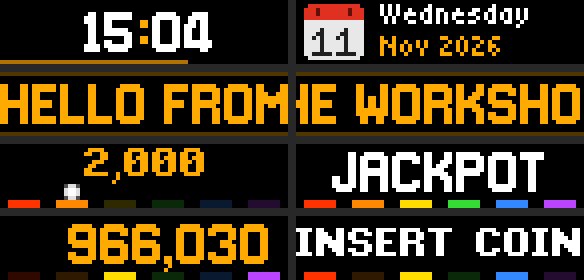
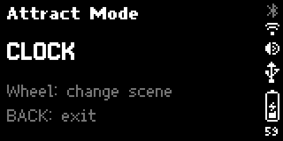
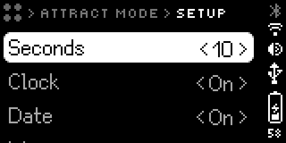

# Attract Mode

A show for the bar's front screen, made in this shop. It runs on the bar
itself, with the PC off if need be, and plays four scenes in turn: the time,
the date, a message, and a pinball machine waiting for a coin.



**Status:** version 0.1.0, built and installed 2026-11-11 on firmware 1.3.1.
Everything on this page was tried on the bar that day. Presses of the buttons,
the wheel and the selector were sent from the PC (`POST /api/input`), not made
by hand, so the physical controls are the one thing still *untested*.

## Use it

Selector on **Apps**, wheel to **Attract Mode**, press the wheel, then
**Start**.

| Control | What it does |
|---|---|
| Wheel | One way goes to the next scene, the other way to the one before |
| BACK, short | Ends the show. The bar goes back to Attract Mode's Start / Setup screen; BACK again for the APPS menu |
| BACK, long | The bar's own force-quit, for any app |
| Selector | Moving it off Apps closes the show. Moving it back to Apps starts the show again by itself |

That last row is what makes it a screensaver. Leave the show running, flip to
BUSY when you're busy, flip back to Apps when you're done, and it is playing
again within a second. It always restarts at the clock.

The back screen, the one facing you, says which scene is on and what the
controls do:



**It can't start itself.** The firmware has no idle timer an app could hook
into, so somebody has to open it once.

### With other things on the bar

- **A BUSY or CUSTOM session** needs the selector moved, and that closes the
  show. Nothing to fight over.
- **Programs on the PC** that draw at priority 51 or more take the screen from
  it. When they let go, the show is back in under a second. That is the right
  way round for alerts.
- **The manager's apps** draw at priority 10 unless told otherwise, so while
  the show runs they are refused. The show and the manager's scroller are two
  ways of doing the same job; run one or the other.

## Set it up

On Attract Mode's Start / Setup screen, choose **Setup**. To change a row,
press the wheel, turn it, and press again.



| Row | What it does | From |
|---|---|---|
| **Seconds** | How long each scene stays up: 5 to 60, in fives | 10 |
| **Clock**, **Date**, **Message**, **Pinball** | Whether that scene is in the show. With all four off, the clock plays anyway | On |
| **Text** | What the Message scene says, up to 64 characters. The bar shows it here but can't edit text: change it from the PC, below | Hello from the workshop |
| **Time format** | 24-hour or 12-hour | 24-hour |

To change the text, or anything else, from the PC:

```powershell
python soft-tools/scripts/busybar_app.py settings shop.attract-mode "message=Back at 3"
python soft-tools/scripts/busybar_app.py settings shop.attract-mode seconds=15 show_date=false
python soft-tools/scripts/busybar_app.py settings shop.attract-mode
```

The last line just shows the settings. The bar's own web page should be able
to edit them too (Flipper's doc; not tried here).

A change made while the show is running shows up at the next change of scene.
The app reads its settings each time it moves on.

The message is always drawn in capitals: the big font has no small letters. A
line too long for the screen scrolls, and the scene stays up for as many whole
trips round as come closest to **Seconds**, so the line is never cut off part
way.

## Change it

The app is the folder
[`soft-tools/bar-apps/shop.attract-mode/`](../../soft-tools/bar-apps/README.md).
After an edit:

```powershell
node soft-tools/bar-apps/check_app.mjs soft-tools/bar-apps/shop.attract-mode
python soft-tools/scripts/busybar_app.py install soft-tools/bar-apps/shop.attract-mode --launch
```

The first line runs the app on the PC against a stand-in for the bar. Two and
a half minutes of show pass in under a second, across a New Year's midnight,
with the wheel turned and BACK pressed, and every request is checked against
the bar's rules. The second line packs the folder, installs it over the old
one and starts it. Settings survive a reinstall.

The pictures (the two menu icons and the calendar leaf) are drawn by
[`make_art.py`](../../soft-tools/bar-apps/make_art.py), as text, one character
a pixel. Run it after changing one.

To take the app off the bar:

```powershell
python soft-tools/scripts/busybar_app.py remove shop.attract-mode
```

## How it's built

Each file teaches one thing about writing for the bar. Read them in this
order; the comments at the top of each say the same in more detail.

| File in `scripts/` | The lesson |
|---|---|
| `bar.js` | **The four calls.** Draw, remove some elements, clear everything, read the settings. An app on the bar makes them to `localhost` |
| `elements.js` | **What a scene is made of:** text, boxes, pictures. Every id belongs to one scene and never changes type |
| `clock.js` | **Anchor points do the layout.** The hours are pinned by their right edge and the minutes by their left, both to the colon. Digits vary in width; the colon never moves |
| `date.js` | **Pictures ship with the app.** The calendar leaf is a PNG in the app's folder, drawn by its path, with ordinary text laid over it |
| `message.js` | **Let the bar do the moving.** A long line is drawn once, with a width and a scroll speed, and the firmware slides it round like a marquee |
| `font.js` | **Measure what the bar won't tell you.** The widths of every character in the big font, measured on the bar, so the app knows whether a line fits |
| `pinball.js` | **Animation is a function of time.** Told how long the scene has been up, it describes the whole frame: ball, score, lamps |
| `main.js` | **Describe the whole frame; send only the difference.** The runner compares each frame with what is on screen, draws what changed, removes what is gone |

Three things in `main.js` exist because of how the bar behaved in testing:

- **Scene changes cut to black.** A black box goes up over everything, the old
  scene is removed behind it, the new one is drawn, and the box comes off. Old
  and new are never seen together, and the screen is never left empty. An
  empty screen makes the bar show its own "Loading…" screen.
- **The whole frame is sent again once a second,** changed or not. When a
  program on the PC takes the screen, the bar wipes this app's elements and
  tells it nothing. The resend puts them back.
- **Scrolling text is left out of that resend.** Sent again, it starts its
  scroll over.

## What the tests showed

- **All four scenes play in order** and the settings do what they say,
  including 12-hour time and a short message that doesn't scroll.
- **A change of scene** takes about a fifth of a second of black.
- **The pinball scene** aims for 15 frames a second. The PC, reading the
  screen 15 times a second, saw 10 or 11 new frames a second. Reading slows
  the app down, so the real figure is somewhat higher.
- **After a PC program held the screen for three seconds,** every scene was
  back, whole, 0.7 to 1.0 seconds after it let go. After a third of a second,
  the still scenes were back in under half a second.
- **Opened from the APPS menu,** flipped off in Setup and on again, left with
  BACK, closed and restarted by the selector: all as described above.

## Known limits

- **The physical controls haven't been tried by hand.** The simulated presses
  go through the same path in the firmware, so they should match.
- **The message can go missing for a few seconds** if another program takes
  the screen for less than a second and gives it back between two resends.
  The thin lines come back and the text doesn't, until the scene's turn ends.
  It didn't happen in testing.
- **The bar updates itself.** A new firmware could change any of this. If the
  show misbehaves after an update, run the two commands under *Change it*.
