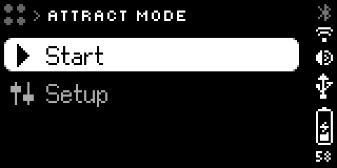
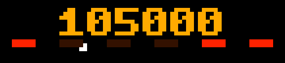
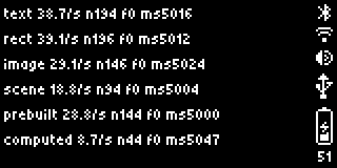

# Apps on the bar

A bar app is a small JavaScript program that lives on the bar itself. It shows
up in the APPS menu and runs with the PC off. Flipper's Clock and Weather are
bar apps, and so is this shop's [Attract Mode](attract-mode.md). For apps that
run on this PC and use the bar as a screen, see
[writing-apps.md](writing-apps.md).

**Status:** checked 2026-11-11 on firmware 1.3.1, by building, installing and
running two apps over USB (a throwaway speed test, then Attract Mode) and by
reading Flipper's Clock out of the bar's storage. What was only read from
Flipper's doc or the firmware's source is marked *not tried here*. Presses of
the bar's controls were sent from the PC with `POST /api/input`, not made by
hand.

## What it can and can't do

A bar app can:

- Draw on both screens, with the same elements an HTTP app uses
  ([http-api.md](http-api.md)).
- Read the buttons and the wheel.
- Show pictures that ship inside its own package.
- Read its own settings, which you change on the bar under Setup.
- Play sounds, set brightness and volume, read the time, and read or set the
  BUSY timer (Flipper's doc; not tried here).
- Fetch from the internet while the bar is on Wi-Fi (Flipper's doc; not tried
  here).

It can't:

- **Start by itself.** The firmware has no idle or screensaver hook; a search
  of its source finds none. Someone opens the app from the APPS menu, or a
  program on the PC sends `POST /api/apps/launch`. One thing comes close:
  move the selector off Apps while an app is running and the app closes, then
  move it back and the bar starts that app again.
- **Run in the background.** One app runs at a time, and moving the selector
  off Apps closes it.
- **Start, stop or steer anything else:** not another bar app, and not a
  program on the PC. Pinball and the rest of the community library are PC
  programs, so a bar app can't show them.
- **Upload pictures or sounds while it runs.** That call is closed to it.
  Whatever it shows ships in its package or is drawn from code.
- **Change its own settings.**

## The package

One folder, named for the app's id:

```text
shop.example/
  appmeta/
    manifest.json          required
    settings.json          optional: what the bar offers under Setup
    icon_front_8x8.png     optional: 8 x 8, colour
    icon_back_11x11.png    optional: 11 x 11, grey
  scripts/
    main.js                required: where the app starts
  images/                  optional: any other folders the app needs
```

The id is at most 32 characters: letters, digits, `_`, `-` and `.`, not
starting with a period. The folder name and the manifest's `id` must match.

```json
{
    "format_version": 1,
    "id": "shop.example",
    "name": "Example",
    "version": "0.1.0",
    "api_version": "27.14.0"
}
```

| Optional field | What it does |
|---|---|
| `description`, `author` | Shown with the app |
| `heap_size_kib` | Memory for the script: 128 unless you say otherwise, 512 at most |
| `debug` | `true` hides the app unless developer mode is on |

The firmware only checks that `api_version` isn't newer than its own.

Icons are PNG files, 8 bits a channel with alpha, the same as Flipper's own.
Leave them out and the bar uses a stock icon.

The package is a gzipped tar that holds the folder itself.
[busybar_app.py](../../soft-tools/scripts/busybar_app.py) packs it that way.
So does `tar -czf shop.example.tgz -C <the folder above it> shop.example`,
which is what Flipper's own `busy-cli build` runs. The bar took both.

Flipper's [busy-tools](https://github.com/busy-app/busy-tools) (`npm create
@busy-app/app`, then `busy-cli`) add TypeScript, bundling and one-command
installs. They need Node 24. Hand-written JavaScript needs none of it.

## On and off the bar

```powershell
python soft-tools/scripts/busybar_app.py install soft-tools/bar-apps/shop.attract-mode --launch
python soft-tools/scripts/busybar_app.py list
python soft-tools/scripts/busybar_app.py quit
python soft-tools/scripts/busybar_app.py remove shop.attract-mode
```

Underneath, these are the calls. All of them work over USB with no password,
and they're local only: the cloud API doesn't offer them.

| Step | Call |
|---|---|
| Upload | `POST /api/apps/stage`, with the `.tgz` as the body and `Content-Type: application/octet-stream`. The answer carries an `install_key` |
| Install | `POST /api/apps/install?install_key=…`. Installing over an app replaces it and keeps its settings |
| Start | `POST /api/apps/launch?app_id=…`. 409 means something with a higher priority is running |
| Stop | `POST /api/apps/quit` |
| Remove | `DELETE /api/apps?app_id=…`. Saved settings stay; `DELETE /api/apps/settings?app_id=…` puts them back to their defaults |
| See what's installed | `GET /api/apps/list` |

After a remove, the app was gone from the list and from `/ext/user_assets`.

Started through the API, an app runs at once: its first frame was up within a
second. Opened from the APPS menu, the bar first offers **Start** or
**Setup**:



When the app's script ends, the bar comes back to this screen. BACK from here
returns to the APPS menu.

## What the script has to work with

The interpreter is JerryScript. Flipper's Clock (0.6.1, on this bar) and
Attract Mode both use `import` and `export` between files in `scripts/`,
`async` and `await`, arrow functions and template literals, so all of that
runs.

- **`fetch("http://localhost/api/…")`** reaches the bar's own API. Only these
  are open to an app (Flipper's doc):

  | Endpoint | Methods |
  |---|---|
  | `display/draw` | POST, DELETE |
  | `display/brightness`, `audio/volume` | GET, POST |
  | `audio/play` | POST, DELETE |
  | `busy` | GET, PUT |
  | `apps/settings` | GET, for its own `app_id` only |
  | `name`, `time`, `wifi/status`, `version`, `access`, `transport`, `status` and its sub-pages | GET |

- **`listen("input", handler)`** delivers the controls, and returns the
  function that stops listening. Each event has a `key` (`ok`, `start`, `back`
  or `encoder`) and an `action` (`short`, `long`, `press`, `release`,
  `repeat`; for the wheel `clockwise` or `counterclockwise`, with `delta` 1 or
  -1).
- **`setTimeout`, `setInterval`, `Date`, `console`.**

The app ends when nothing is left waiting: no listener, no timer. A short
BACK is the app's to handle; Clock and Attract Mode both end on it. A long
BACK force-quits any app, and the app never sees it.

Clock draws at priority 50, and so do this shop's apps.

## How the screen behaves

Found by trying, 2026-11-11. An app that knows these avoids every glitch seen
while building Attract Mode.

- **Draws add up.** Each draw adds its elements to what the app already has
  on screen. An element sent again under the same id moves or changes in
  place.
- **An id can't change type.** Send a rectangle under an id that was text and
  the bar answers 400. The old element stays.
- **Elements can be removed one by one:** `DELETE /api/display/draw` with a
  body of `{"application_name": "…", "element_ids": ["a", "b"]}`. The app's
  name goes in the address or in the body, never both; both answers 400.
- **An empty screen shows "Loading…".** The bar puts up its own spinner
  whenever a running app has nothing drawn: for the first half second after
  launch, and any time the app clears everything. To change scene cleanly,
  cover the old one with a black box, swap behind it, then remove the box.
- **Pictures in the package draw by path:** an `image` element with
  `"path": "images/leaf.png"` and the app's id as `application_name`.
- **Being outranked is silent.** A program on the PC that draws at 51 or more
  takes the screen from a bar app drawing at 50, and the bar wipes the app's
  elements without telling it. While outranked, each draw the app sends is
  held for a second and a half, then refused with 409. When the other program
  lets go, the screen is empty until the app draws again. So an app should
  send its whole frame again every second or so, changed or not.
- **Text with a `width` is a window.** The text sits at the window's left
  edge, whatever `align` says. With a `scroll_rate`, text longer than the
  window rests for `scroll_start_delay`, slides left at that many pixels a
  minute, comes round again about 12 pixels behind its own tail, rests for
  `scroll_repeat_delay` at its starting position, and repeats. The firmware
  does all of it; the app draws once.
- **Scrolling text starts over when sent again,** even unchanged. Leave it out
  of any regular resend.
- **A box with a `radius` is a smooth disc.** A 4 × 4 box with radius 2 makes
  a ball. The alpha in a colour dims it toward black, and `z_index` decides
  what is in front.

The fonts' sizes are in [http-api.md](http-api.md). The bar gives an app no
way to ask how wide a line of text will come out, so Attract Mode carries a
table of measured widths for the one font where it matters.

**Trying an app without the bar:**
[check_app.mjs](../../soft-tools/bar-apps/check_app.mjs) runs an app's scripts
on the PC against a stand-in that enforces the rules above, with a fake clock
and scripted presses. A pass there isn't proof: the bar's JavaScript engine is
a different one, and the checker knows only the rules on this page. The
silent wipe above was found on the bar, not by the checker.

**Pressing the bar's controls from the PC:** `POST /api/input?key=…`. `up`
and `down` are the wheel (`up` moves down a menu, and reaches an app as
`clockwise`), then `ok`, `back`, `start`, and the selector's positions:
`busy`, `custom`, `off`, `apps`, `settings`.

## How fast it can draw

Measured 2026-11-11. A test app drew one frame after another for five seconds,
waiting for the bar's answer each time, and counted the draws the bar
accepted. All of them were.

| Kind of frame | Draws a second |
|---|---|
| One line of text, changing every frame | 39 |
| One small block, moving a pixel a frame | 39 |
| One picture from the package, moving a pixel a frame | 29 |
| A scene of eight elements, all changing: a score, a ball, six lamps | 19 |
| A full-screen bitmap (`xpmbitmap`), four frames made ahead and cycled | 29 |
| A full-screen bitmap, every pixel worked out in code each frame | 9 |



A second run checked that accepted draws really reach the screen. While the
app ran, the PC read `/api/screen` about seven times a second. The app counted
37 draws a second for the moving block, and on screen the block moved 37
pixels a second. That run was about 5% slower all round, because the PC's
reads share the bar's attention.

What it means: pinball from the community library aims for 15 pictures a
second from the PC. A bar app built from text, shapes and packaged pictures
can outrun that. Working out every pixel in code is the slow path; keep that
for small areas, or make the frames ahead of time. Sending only the elements
that changed is quicker still.

The results, as the test app drew them on the back screen. Per line: draws a
second, draws accepted, draws refused, and the milliseconds it ran.



## Settings

`settings.json` lists the app's settings: boolean, integer, string, enum,
color, time and geolocation, optionally in groups. The firmware draws the
Setup screen from it, in the file's order, so the app needs no settings screen
of its own. Labels longer than about eight characters are cut short on the
front screen.

- **On the bar,** choose Setup, press the wheel on a row, turn it, press
  again. That works for boolean, integer and enum settings. A string shows its
  value but can't be edited there on 1.3.1 (firmware source); Flipper's doc
  names only color and geolocation as off limits.
- **From the PC,** `PUT /api/apps/settings?app_id=…` replaces the whole
  settings document, `{"version": 1, "values": {…}}`, with every field
  present. `busybar_app.py settings <id> name=value` does the reading and
  writing for you. The bar's web page should be able to edit them too
  (Flipper's doc; not tried here).
- **The running app** reads its values with
  `GET /api/apps/settings?app_id=<its own id>`. To notice a change while it
  runs, it has to read them again.

## A worked example

[Attract Mode](attract-mode.md) is the shop's first bar app, built so that
each file teaches one thing: the calls, anchors, pictures, firmware-scrolled
text, measured fonts, animation, and a runner that sends only what changed.
Its source is in
[`soft-tools/bar-apps/`](../../soft-tools/bar-apps/README.md).

## Sources

- Flipper's doc, at firmware tag 1.3.1: `documentation/JavaScript
  Applications.dox.md` in
  [busybar-firmware](https://github.com/busy-app/busybar-firmware/tree/1.3.1).
- Firmware source at 1.3.1: the installer
  (`applications/services/js_app_installer/`), the app launcher's Start, Setup
  and Run scenes, `desktop.c` for what the selector does, and the display
  tests for the `xpmbitmap` format.
- [busy-tools](https://github.com/busy-app/busy-tools): `packages/cli/src/lib/build.ts`
  for how a package is packed, `device.ts` for what each error means.
- The bar's own `openapi.yaml` (27.14.0).
- Flipper's Clock 0.6.1, read from `/ext/user_assets/app.busy.clock/` on this
  bar.
