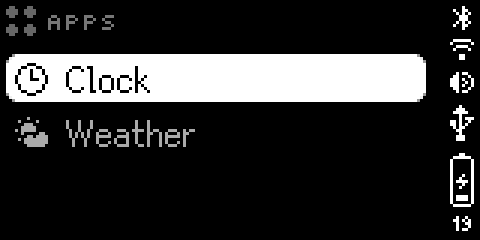
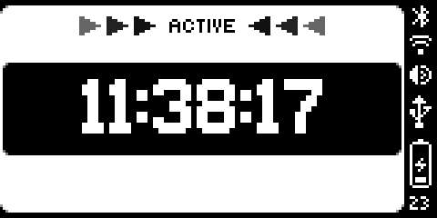

# The device

What's on the bar, what each control does, and what each mode means for apps
drawn over the HTTP API. Hardware and controls come from the official docs
(docs.busy.app/bar, read 2026-11-11). The API names and priorities come from the
firmware's spec (1.3.1).

## Screens

| | Front | Back |
|---|---|---|
| Type | RGB LEDs | White OLED, 1.54″ |
| Pixels | 72 × 16 | 160 × 80 |
| Colour | Full colour; the API takes `#RRGGBBAA` | 16 grays |
| In the API | `"display": "front"` (the default) | `"display": "back"` |

*Both screens in Apps mode, captured over USB with
[busybar_screens.py](../../soft-tools/scripts/busybar_screens.py).*

While an HTTP app holds the screen, the back shows the bar's own **ACTIVE**
view: the word ACTIVE over a grey copy of the front. Neither the clock nor
pinball draws on the back; this view is the firmware's.

## Controls

| Control | Normal use | During a session | API key¹ |
|---|---|---|---|
| **Mode selector** | Picks one of the five modes below | — | `busy` `custom` `off` `apps` `settings` |
| **Start / Pause**, the big button | Starts or pauses a mode; also OK | Pause | `start` |
| **Scroll wheel**, turned | Moves through menus | Adjusts the time | `up` `down`² |
| **Scroll wheel**, pressed | OK, or Skip | Skips the current phase | `ok` |
| **Back** | Goes back, or exits an app | **Ends the session at once** | `back` |

¹ The key `POST /api/input?key=…` takes to press it remotely. The manager's
Controller tab sends these.
² The API has no wheel key; `up` and `down` stand in for turning it. `up`
moves down a menu, and an app on the bar receives it as `clockwise` (seen
2026-11-11).

Holding Back force-quits an on-bar JavaScript app (firmware docs). A short
press closes an HTTP app's frame and returns the bar to its own screen, and so
does moving the selector (measured by busybar-wm). An app that keeps redrawing
comes straight back, though; see [sharing-the-screen.md](sharing-the-screen.md).

## Modes

| Position | API key | What it is (official docs) | Manager apps³ |
|---|---|---|---|
| **BUSY** | `busy` | "Main focus mode, by default set to BUSY interval timer" | Show until you start a session, then wait for it to end |
| **CUSTOM** | `custom` | "Second focus mode, by default set to custom status" | Same as BUSY |
| **Sleep** | `off` | "Sleep mode with both screens off" | Show anyway: Sleep can't hold the screen against them (seen 2026-11-11) |
| **Apps** | `apps` | "Clock, Weather, and user-added apps" | Show, over the menu |
| **Settings** | `settings` | "Wi-Fi, Bluetooth, brightness, sound, firmware update, and more" | Show, over the menu |

³ At the manager's default priority, 10. Why, in
[sharing-the-screen.md](sharing-the-screen.md).

An app opened from the APPS menu closes when the selector leaves Apps, and
the bar starts it again when the selector comes back (seen 2026-11-11 with
Attract Mode, the selector moved through the API).

BUSY and CUSTOM are the same machine under two names: "BUSY is intended as your
main focus mode, while CUSTOM works as a status indicator for people around you.
… In practice, both modes offer the same functionality." Each mode holds a
profile (a title, a timer, a theme and a smart-home trigger), which the API can
read and replace at `/api/busy/profiles/busy` and `/api/busy/profiles/custom`.
The timer is one of three kinds:

| Timer | What it does |
|---|---|
| Interval | BUSY and REST phases for a set number of cycles, with optional autostart. BUSY's default |
| Simple | Counts down a fixed time |
| Infinite | Runs until you stop it |

A *session* is a running timer. On 1.3.1 a session, running or paused, blocks
every HTTP draw whatever its priority. The spec still says 90; see
[sharing-the-screen.md](sharing-the-screen.md). That's the point: while you're
busy, the bar says so.

## Three kinds of app

"App" means three different things around this bar:

| Kind | Runs on | Gets there by | In the APPS menu |
|---|---|---|---|
| **Built-in**: Clock, Weather | The bar | Comes with the bar. Under the hood these are JavaScript apps too, like the next row | Yes |
| **JavaScript app**, a `.tgz` | The bar, in its JavaScript interpreter | Installing through `/api/apps/*`, or Flipper's [busy-tools](https://github.com/busy-app/busy-tools) | Yes |
| **HTTP app**: everything busybar-manager runs, the whole community library included | This PC, as a Python program | The manager downloads it into its own folder. It draws with `POST /api/display/draw` | No |

The first two live on the bar and run with the PC off. The third stays on this
PC: the manager's **Install** button downloads a Python program here, and the
bar is only its screen. Stop the manager or unplug the bar and it stops
drawing. Pinball, for one, works out a whole new picture on the PC, uploads it
to the bar and draws it, aiming for 15 a second. The only trace it leaves on
the bar is four picture files under its name in `/ext/user_assets`.

`GET /api/apps/list` shows what's really on the bar. On 2026-11-11 that was
Clock 0.6.1 and Weather 0.6.2, both Flipper's, and JS App Example 0.1.0, the
BUSY Bar team's sample. Later that day the shop's own
[Attract Mode](attract-mode.md) joined them.

This folder is mostly about the third kind. An HTTP app can reach anything the
PC can: files, other APIs, other programs. [bar-apps.md](bar-apps.md) covers
the second kind: what a bar app can do, how one gets on and off the bar, and
how fast it can draw. The official docs say an apps catalogue for JavaScript
apps is "coming soon".

## Connections and power

- **USB-C** carries power, charging and a network link at once. Windows lists
  the bar as a *Flipper FZCO Network Interface*. The bar is `10.0.4.20`; this PC
  got `10.0.4.21`. There's no password: "A USB connection is considered a
  secure communication channel, so authentication is not used."
- **Wi-Fi.** The API is off over Wi-Fi by default. Turning it on takes a
  password, sent as `X-API-Token`. How, in [http-api.md](http-api.md).
- **Bluetooth and Matter.** The bar can pair with a smart home and act as a
  switch in it. A mode's profile has a `trigger_smart_home` setting, presumably
  flipping that switch when a session runs. Not explored.
- **Battery.** It reports charging, charged or discharging, and it refuses a
  firmware install when the charge is low.
- **Firmware** updates itself: auto-update is on, inside a time window you can
  set. An update can change the API under these pages.

## The bar's own web page

`http://10.0.4.20/` over USB. The emulator's copy of it has Network, Firmware,
Settings and Draw tabs. The official docs turn on Wi-Fi API access in its
Network tab. Not explored here.
