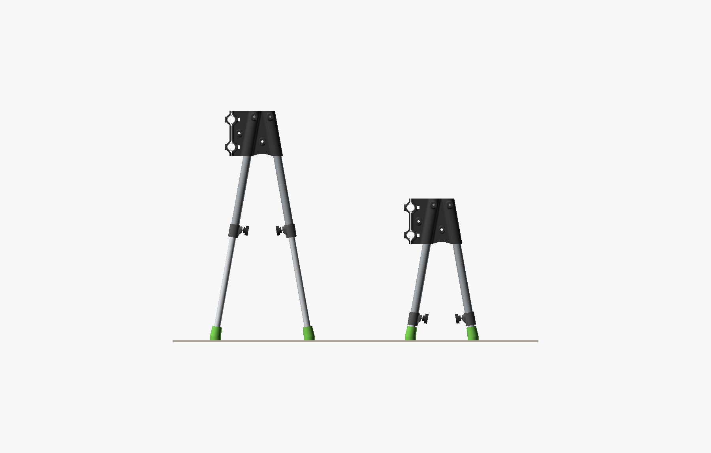
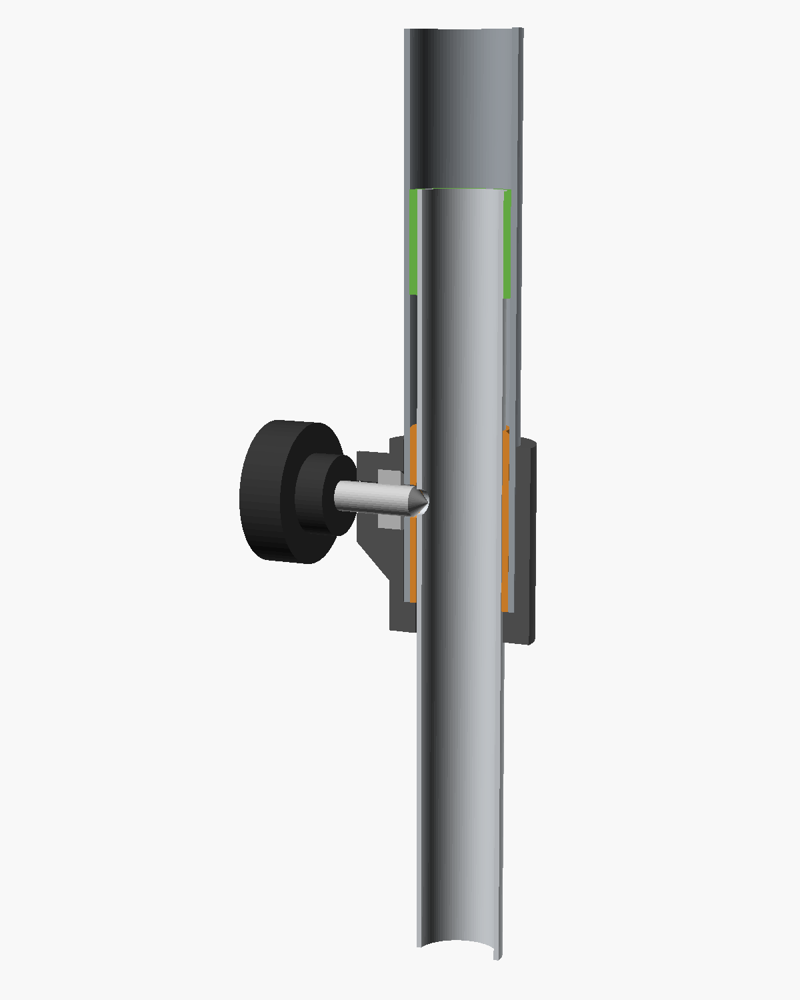
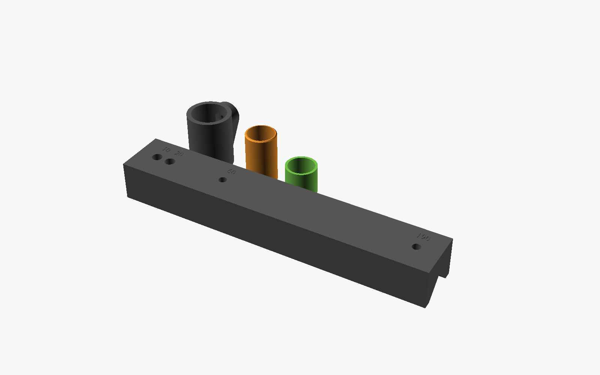

# Overhead rig legs — telescoping, from conduit

Height-adjustable legs for flummer's
[Tabletop overhead shooting rig](https://makerworld.com/en/models/1556093-tabletop-overhead-shooting-rig),
made from steel electrical conduit instead of carbon tube. His joiners, clamps,
camera holder, feet and finger screws are used unchanged, just regenerated at
the new tube sizes. This folder adds the four parts the legs need.

**Status:** designed, rendered and checked on screen. Nothing is printed, cut or
built yet. What only a tape measure and a test leg can prove is still unproven.



*One side of the rig, seen along the bars. Left: the tallest hole, hub top at
668 mm, which is flummer's stock height. Right: the lowest hole, 412 mm. The
legs only slide along their own lines, so the feet move in as the rig comes
down.*

## What you get

- **Three heights:** hub top at 668, 540 or 412 mm above the table.
- **Level by counting:** set all four legs to the same hole and the rig is
  parallel to the table. No measuring.
- **A smaller footprint going down:** feet 272 mm apart front to back at the
  top setting, 182 mm at the bottom.
- **About $25 of conduit** instead of $120+ of carbon tube.

## How the leg works



From the top down:

- **Upper tube.** 3/4" EMT, 360 mm. It sits in flummer's joiner exactly the
  way his carbon tube did: top end against the bottom of the socket, held by
  an M6 × 50 finger screw through a cross hole 10 mm from the top.
- **Lower tube.** 1/2" EMT, 380 mm. It slides inside the upper tube and has
  three 5 mm height holes on one face.
- **Top bushing (green, TPU).** Sits on the top of the lower tube and drags
  slightly in the upper tube's bore. That takes out the rattle, and the leg
  doesn't drop when you unlock it.
- **Sleeve (orange).** Pressed into the mouth of the upper tube. It fills the
  1.5 mm gap between the two conduit sizes.
- **Collar (dark).** Slips over the bottom of the upper tube and holds the nut.
- **Locking screw.** An M6 × 30 bolt with its tip ground to a point, in one of
  flummer's finger screws. The point drops into a height hole and pushes the
  lower tube against the sleeve. The hole sets the height; the push takes out
  the play.
- **Foot.** flummer's, regenerated for the smaller tube, keyed into a slot.

## Heights

Holes are measured from the top end of the lower tube.

| Hole | Hub top | Top bar (centre) | Bottom bar (centre) | Feet, front to back |
|---|---|---|---|---|
| 60 | 668 (stock) | 642 | 562 | 272 |
| 190 | 540 | 514 | 434 | 227 |
| 320 | 412 | 386 | 306 | 182 |

All in mm above the table. How far the lens hangs below the bars depends on
your camera and lens, so measure your own.

### Before you cut the upper tubes

The upper tube's length sets the lowest height, and it's the one cut you can't
take back. So find your range first: set the camera at a few heights over real
work (books, boxes, a tripod) and note the lowest lens height you'd actually
use.

If 412 isn't low enough, shorten both tubes:

| Upper | Lower | Holes | `Hole_Spacing` | Hub top range |
|---|---|---|---|---|
| 360 | 380 | 60 / 190 / 320 | 130 | 412 – 668 |
| 330 | 350 | 60 / 175 / 290 | 115 | 382 – 609 |
| 300 | 320 | 60 / 160 / 260 | 100 | 353 – 550 |

The rule behind the table: lower = upper + 20, and the holes go at 60, at
half the lower tube's length, and at 60 from its bottom end. Every 10 mm off
the upper lowers the bottom of the range by 10 and the top by 20. Set
`Hole_Spacing` and re-export the drill jig.

## Shopping list

### Conduit

- 3/4" EMT, one 10 ft stick: two bars at 660 and four uppers at 360. That's
  2,760 mm, leaving 288 spare.
- 1/2" EMT, one 10 ft stick: four lowers at 380. That's 1,520 mm, leaving
  1.5 m spare.

### Hardware

- flummer's list: 8 × M6 × 50 hex bolts, 8 × M6 nuts, 1 × 1/4"-20 × 1" hex
  bolt, 5 × 1/4"-20 nuts.
- For the legs: 4 × M6 × 30 hex bolts, 4 × M6 nuts.

### Filament

- PLA or PETG for flummer's parts. He printed PLA, about 520 g.
- PETG for the collars and sleeves.
- TPU 95A for the top bushings, and for the feet if you want grip.

### Tools

- Tubing cutter or hacksaw, and a deburring tool or file.
- Drill with 6.5 mm and 5 mm bits. For 1/4" and 13/64" bits, set `Bolt_Drill`
  to 6.35 and `Seat_Drill` to 5.16 and re-export.
- A clamp and calipers.

## Print



| Part | File | Qty | Material | Notes |
|---|---|---|---|---|
| Joiner, left | `stl/from-flummer/joiner_left_23.4.stl` | 1 | PLA/PETG | flummer's, at 23.4 mm |
| Joiner, right | `stl/from-flummer/joiner_right_23.4.stl` | 1 | PLA/PETG | flummer's, at 23.4 mm |
| Clamp | `stl/from-flummer/clamp_23.4.stl` | 2 | PLA/PETG | flummer's, at 23.4 mm |
| Camera holder | `stl/from-flummer/camera_holder_23.4.stl` | 1 | PLA/PETG | flummer's, at 23.4 mm |
| Foot | `stl/from-flummer/foot_18.stl` | 4 | TPU or PLA | flummer's, at 18 mm |
| Finger screw | `stl/from-flummer/finger_screw.stl` | 12 | PLA/PETG | 8 for the rig, 4 for the legs |
| Finger screw, 1/4" | `stl/from-flummer/finger_screw_us.stl` | 1 | PLA/PETG | camera screw, print in another colour |
| Collar | `stl/collar.stl` | 4 | PETG | 4 walls, 40% infill: it carries the screw's push |
| Sleeve | `stl/sleeve.stl` | 4 | PETG | |
| Top bushing | `stl/top-bushing-tpu.stl` | 4 | TPU 95A | |
| Drill jig | `stl/drill-jig.stl` | 1 | PLA/PETG | 209 mm long |

The four new parts are exported in print orientation and need no supports.
flummer's parts come out in the orientation his file exports them in; his
MakerWorld print profile shows how he printed them (0.2 mm layers, 3 walls,
15% infill).

### Regenerating flummer's parts

`stl/from-flummer/` holds his files, so it stays on this machine and isn't
republished here (it's in `.gitignore`). If it's missing, get his files with
**Download STL/CAD Files** on the model page and run his `.scad` at your
measured tube sizes:

```sh
openscad --backend Manifold -D Tube_Diameter=23.4 -D 'Part="RightJoiner"' -o joiner_right_23.4.stl OverheadShootingRig.scad
```

Do the same for `LeftJoiner`, `Clamp` and `CameraMount` at 23.4, and for
`Foot` at 18. Enter the tube's measured outside diameter; his file adds 0.3 mm
of clearance to the joiner and clamp bores and 0.1 mm to the foot. His
customizer slider steps in whole millimetres, so MakerWorld's own customizer
may not accept 23.4. OpenSCAD itself takes any value.

### This folder's parts

`overhead-rig-legs.scad` exports `Collar`, `Sleeve`, `TopBushing` and
`DrillJig`. `Preview`, `Section` and `Parts` are for looking. Measure your
conduit and set `Upper_Tube_Diameter`, `Upper_Tube_Bore` and
`Lower_Tube_Diameter` before exporting. The fits are under Advanced.

## Cut

Cut the bars and lowers first. Cut the uppers last, after you've settled your
height range.

| Piece | Conduit | Qty | Length (mm) |
|---|---|---|---|
| Bar | 3/4" | 2 | 660 |
| Lower leg | 1/2" | 4 | 380 |
| Upper leg | 3/4" | 4 | 360 |

Cut square and deburr every end, inside and out, because the sleeve and
bushing ride on the bore. If a sleeve won't go into the 3/4" tube, look for a
weld seam inside and file it flush.

## Drill

Every hole goes through the jig. It's a V-block: set it on top of the tube, V
side down, with the tube end hard against the stop, and clamp it. Each guide
drills straight down through the middle of the tube. Every leg gets drilled
from the same stop through the same guides, so all four come out the same, and
that's what keeps the rig level.

**Upper tubes:**

1. Top end against the stop. Drill 6.5 mm through guide **10**, through both
   walls. This is the hub hole that flummer's finger screw goes through.
2. Bottom end against the stop. Push a 6 mm bit through the hub hole at the
   far end and turn the tube until the bit sits level, parallel to the bench.
   Drill 6.5 mm through guide **20**, top wall only. This is the collar hole,
   a quarter turn round from the hub hole.

**Lower tubes:**

1. Top end against the stop. Drill 5 mm through guides **60** and **190**,
   top wall only.
2. Bottom end against the stop. Drop a 5 mm bit through guide **190** into
   the hole that's already there. It pins the tube so the last hole lines up.
   Drill through guide **60**, top wall only. This hole is 320 mm from the top.
3. Cut the foot slot at the bottom end: 6 mm wide and 20 mm deep, through both
   walls, a quarter turn round from the height holes. With a height hole
   facing up, the slot runs side to side. Make two hacksaw cuts, break out the
   middle and file it square.

**Bars:** follow flummer's spec. Drill a 6.5 mm hole through guide **10** at
one end, through both walls. At the other end, cut a 6 × 20 mm slot in line
with that hole.

**Locking screws:** grind the last 3 mm of each M6 × 30 to a 90° point. Chuck
the bolt by its head in a drill and run it against a file held at 45°. Then
press the head into a finger screw, the same way flummer's are made.

## Assemble one leg

1. Push a top bushing onto the top end of the lower tube, flush.
2. Slide the lower tube into the bottom of the upper tube, bushing first.
3. Slide a sleeve over the bottom of the lower tube and press it into the
   upper tube's mouth until it's flush. Turn it so its hole lines up with the
   collar hole; a 6 mm bit through both helps.
4. Fit the nut to the collar before the collar goes on the tube. Hold the nut
   in its pocket from inside the bore, thread a locking screw in from
   outside, and tighten it to pull the nut home. flummer uses the same trick
   for his bar nuts. Back the screw out until its point is clear of the bore.
5. Slide the collar over the lower tube and onto the upper tube until the
   tube end sits on the collar floor, with the screw lined up on the collar
   hole. Wind the screw in through the tube and sleeve until its point just
   touches the lower tube. The collar is now held on; setting a height
   (below) finishes the job.
6. Push the foot onto the bottom of the lower tube, with its key in the slot.
7. Fit the leg into the joiner the way flummer designed it: top end to the
   bottom of the socket, M6 × 50 finger screw through the hub hole. Turn the
   leg so its knob faces the other leg of the pair, inside the A.

### Test one leg before making four

Build one complete leg first. Clamp the upper tube horizontally, set the
tallest hole, hang about 2 kg off the foot end and push it around. If you can
feel the joint move, fix it now:

- **Rattle at the collar end:** the sleeve is loose. Reprint it with
  `Sleeve_Fit` at −0.05.
- **Rattle further up the tube:** the top bushing is loose. Reprint it with
  `Bushing_Drag` at 0.3.
- **The knob stem touches the collar before the screw feels tight:** the point
  isn't in a hole, or it's too blunt.

Make the other three once that leg is solid.

## Set a height

1. Back each locking screw out about three turns. The point clears the hole,
   and the bushing stops the leg from dropping.
2. Slide each lower tube to the same hole. You'll feel the point drop in.
3. Tighten until it seats: snug, not cranked. The point does the work, and
   the knob stem should stop about 3 mm short of the collar.

With the same hole on all four legs, the rig sits parallel to the table, even
if the table itself isn't level. For top-down shots, the table is the
reference that matters.

## Why it's built this way

The panel that designed this, with a provisional entomologist sitting in,
started from one question: how do you get a rig lower without the legs taking
up more room?

- **Telescoping, not spreading.** Insects get low by spreading their legs out,
  which costs floor space. A knee joint sticks out sideways. A leg that
  shortens along its own line costs no extra space, and its feet move in as
  the rig comes down.
- **The joint goes low on the leg.** The bending load in each leg is highest
  at the joiner and drops to nothing at the foot. So the thick tube runs into
  the joiner and the adjustable joint sits down where the load is small.
  Tripod legs are built the same way, and so are insect legs, thick near the
  body and thin at the foot.
- **Holes, not friction.** A clamp that grips anywhere has to be set by
  measuring. A point that drops into a hole puts all four legs at the same
  height every time.
- **Soft parts take up the last bit of slop.** The TPU bushings stop the
  rattle, and soft feet let all four legs sit on the table without rocking.

## Numbers from flummer's design

Read from his `.scad` and checked against his published STLs:

- **Leg socket:** bore is tube + 0.3 mm, 10° from vertical, closed 8 mm below
  the hub top, about 126 mm deep.
- **Hub top above the table:** (8 + leg length) × cos 10° + 10. The 10 is
  the foot.
- **Bars:** top bar centre 26 mm below the hub top, bottom bar centre 106 mm
  below.
- **Joiner wall** around the leg socket: 4.15 mm at 23.4, against 4.85 mm at
  his stock 22.

## Credits

The rig is
[Tabletop overhead shooting rig](https://makerworld.com/en/models/1556093-tabletop-overhead-shooting-rig)
by flummer, licensed CC BY-SA. This leg kit is a remix and carries the same
license. The `metric_hex()` module in `overhead-rig-legs.scad` is copied
unchanged from his source. The legs were designed with a Claude-run panel for
the-workshop, and the files were drafted by Claude.
